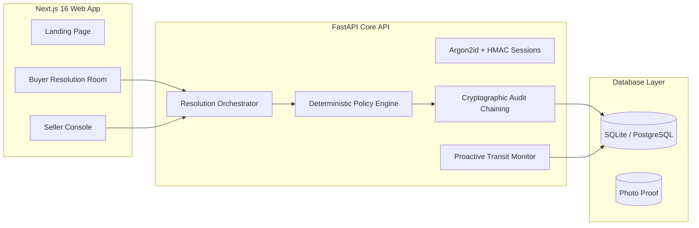

# SellerResolve

> **Autonomous, Policy-Aware Resolution Engine for Small Online Sellers**  
> *Tagline: Investigate. Decide. Act. Verify.*  
> **Team:** Break The Bug | **AgentX Hackathon 2026** | **Problem Statement:** PS-04  

---

## 1. Executive Summary

Answering a customer query is not the same as resolving it. Standard customer support chatbots merely generate text, hallucinate policy exceptions, or require human agents to perform the actual legwork.

**SellerResolve** is an autonomous operational resolution platform:
1. **Investigates:** Connects to trusted order, shipment, and payment records.
2. **Decides:** Applies the seller's deterministic policies (return windows, financial ceilings, photo requirements) through deterministic Python code guards. The LLM never decides policy or financial amounts.
3. **Acts:** Generates prepaid return labels, executes refunds, or escalates high-risk claims to the merchant.
4. **Verifies:** Re-checks courier APIs and payment gateway webhooks to verify operational outcome.
5. **Audits:** Records every turn, tool invocation, and state diff into an immutable, SHA-256 chained audit trail with mathematical tamper detection.
6. **Monitors:** Scans in-transit shipments in the background to proactively grant compensation for transit delays before customers complain.

---

## 2. Key Features

### For Sellers (Merchant Console)
- **4-Step Guided Onboarding:** Connect store, configure logistics SLA and serviceable PIN codes, define policies, review and activate.
- **Structured Policy Manager with YAML Preview:** Configure return windows, financial auto-approval ceilings, instant damage refund thresholds, and transit delay compensation in a typed form. The backend validates the JSON, renders canonical YAML, optionally accepts YAML edits, and publishes an immutable, checksummed version only after explicit confirmation.
- **Human-in-the-Loop Approvals Queue:** Review high-value claims with photographic evidence, customer narrative, and 1-click approve/reject actions.
- **Customer Directory & Store Invites:** Issue cryptographically signed, single-use invite links for buyer onboarding.
- **Cryptographic Audit Log:** Live tamper-evident audit viewer with sequential SHA-256 hash chaining verification and streaming CSV export.

### For Buyers (Customer Portal)
- **Public Seller Directory & Store Portal:** Browse registered merchants, claim orders, and view delivery tracking.
- **Single-Use Invite Redemption:** Seamless store onboarding with automated order discovery.
- **Guided Complaint Intake:** 4-step intake wizard with drag-and-drop photographic evidence uploader and magic-byte signature validation.
- **Interactive Resolution Room (`/buyer/cases/[id]`):** Real-time conversational interface with collapsible **Deterministic Investigation** drawers, tool call telemetry (name, arguments, outcome, timestamp), and high-contrast decision badges (`executed`, `needs_approval`, `not_eligible`).

---

## 3. The 4 Canonical Scenarios (AgentX Hackathon PS-04)

All 4 canonical hackathon scenarios are implemented and validated via automated end-to-end execution:

| Scenario | Order & Amount | Case Details | Engine Evaluation & Action | Decision Badge |
| :--- | :--- | :--- | :--- | :--- |
| **Scenario 1** | `ORD-1001` ($45.00) | Unopened wireless earbuds delivered 5 days ago. | Within 14-day window and <= $50 auto-approve ceiling. Autonomous return approval; prepaid label `RET-99214` generated. | `executed` |
| **Scenario 2** | `ORD-1002` ($89.00) | Apparel return requested 22 days after delivery. | Overdue (> 14-day window). Deterministic rejection with policy citation; zero hallucination. | `not_eligible` |
| **Scenario 3** | `ORD-1003` ($320.00) | 4K display arrived with cracked screen; photo attached. | Claim exceeds $50 auto-approve ceiling. Escalated to Seller Approvals queue. Merchant reviews proof and approves. | `needs_approval` -> `resolved` |
| **Scenario 4** | `ORD-1004` ($110.00) | Package in transit for 6 days (> 5-day delivery SLA). | Proactive Transit Delay Monitor detects stall, issues wallet credit autonomously, and files notice in audit log. | `executed` (proactive) |

---

## 4. Architecture & Security Boundaries



### Strict Non-Negotiable Compliance:
1. **Design System Consistency:** Matches `reference/template/` tokens, dark theme oklch palette, Instrument Serif headings, Instrument Sans body, and JetBrains Mono metadata.
2. **Zero Emoji:** 100% emoji-free across UI, code, comments, commit messages, and agent outputs.
3. **Zero Fabricated Content:** No fake ratings, customer counters, or placeholders (`[X] of [Y]`). Real database records and honest empty states only.
4. **Zero External Runtime Assets:** 100% self-hosted SVGs and canvas animations; zero external blob dependencies.
5. **Deterministic Policy Boundary:** The LLM never determines refund amounts or eligibility. All limits and transitions are computed by deterministic Python code.
6. **Backend Authorization:** Server-side ownership and role checks on every endpoint.

---

## 5. Quickstart & Verification Guide

### Prerequisites
- Python 3.12+ (or 3.14+)
- Node.js 22+ with `pnpm`
- Docker (for the PostgreSQL database)

### 1. Installation & Setup
```bash
# Clone the repository
git clone https://github.com/break-the-bug/sellerresolve.git
cd sellerresolve

# 1a. Start PostgreSQL (default runtime database), from the repository root
docker compose up -d postgres

# 1b. Backend Setup
cd apps/api
python -m venv .venv
# On Windows:
.venv\Scripts\pip install -r requirements.txt
cp .env.example .env    # adjust DATABASE_URL / SECRET_KEY if needed
.venv\Scripts\alembic upgrade head

# 1c. Frontend Setup
cd ../web
pnpm install
```

SQLite remains supported for throwaway local runs: set
`DATABASE_URL=sqlite:///./sellerresolve.db` and run the same Alembic command.
A one-off helper copies an existing SQLite database into PostgreSQL:
```bash
cd apps/api
python ../../scripts/migrate_sqlite_to_postgres.py --sqlite ./sellerresolve.db
```

### 2. Run Automated End-to-End Test Suite
To run all 4 canonical scenarios and verify cryptographic hash chaining:
```bash
# From workspace root:
cd apps/api
.venv\Scripts\python ../../scripts/run-e2e-scenarios.py
```

### 3. Run Backend Unit & Integration Tests
```bash
cd apps/api
.venv\Scripts\python -m pytest tests -q

# Same suite against PostgreSQL (uses a scratch schema and drops it):
TEST_DATABASE_URL="postgresql+psycopg://sellerresolve:<POSTGRES_PASSWORD>@localhost:5432/sellerresolve?options=-csearch_path%3Dsellerresolve_test" \
  .venv\Scripts\python -m pytest tests -q
```

### 4. Run Static Quality & Policy Scanners
```bash
# Python Linting & Formatting
cd apps/api
.venv\Scripts\python -m ruff check .
.venv\Scripts\python -m ruff format --check .
.venv\Scripts\python -m mypy app

# Frontend Linting & Production Build
cd ../web
pnpm run lint
pnpm run build

# Zero Emoji Scanner
node ../../scripts/check-no-emoji.js

# Zero External Asset Scanner
node ../../scripts/check-no-external-assets.js

# Dead Link Scanner
node ../../scripts/check-no-dead-links.js

# Legal Placeholders Scanner
node ../../scripts/check-legal-placeholders.js --production
```

---

## 6. Running the Web Application

```bash
# Terminal 1: Backend API (port 8000)
cd apps/api
.venv\Scripts\python -m uvicorn app.main:app --port 8000 --reload

# Terminal 2: Frontend Web (port 3000)
cd apps/web
pnpm run dev
```

Visit:
- **Landing Page:** `http://localhost:3000`
- **Public Seller Directory:** `http://localhost:3000/sellers`
- **Seller Console:** `http://localhost:3000/seller/dashboard`
- **Autonomous Resolution Room Demo:** `http://localhost:3000/buyer/cases/CAS-1001`
- **Backend Swagger Docs (Dev only):** `http://localhost:8000/docs`

---

## 7. Deliverable Documentation Links

- [System Architecture Specification](docs/architecture.md)
- [REST API Reference](docs/API.md)
- [Database Schema & Entity Relationships](docs/database-schema.md)
- [Database Refactor Plan](docs/database-refactor-plan.md)
- [Database Refactor Final Report](docs/database-refactor-report.md)
- [Policy Engine Schema](docs/policy-schema.md)
- [Operations Runbook](docs/runbook.md)
- [Visual Screenshots Directory](docs/screenshots/)

---

## 8. License

Proprietary prototype for AgentX Hackathon 2026. Built by Team Break The Bug. All rights reserved.

