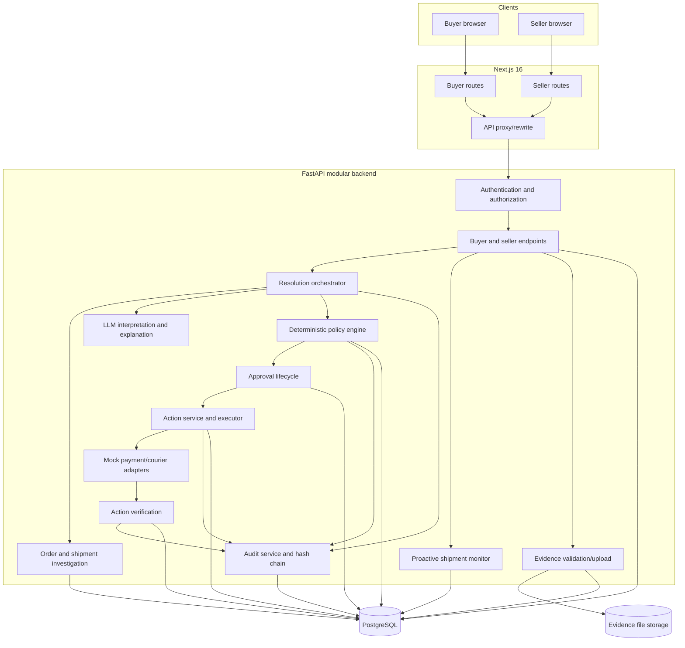
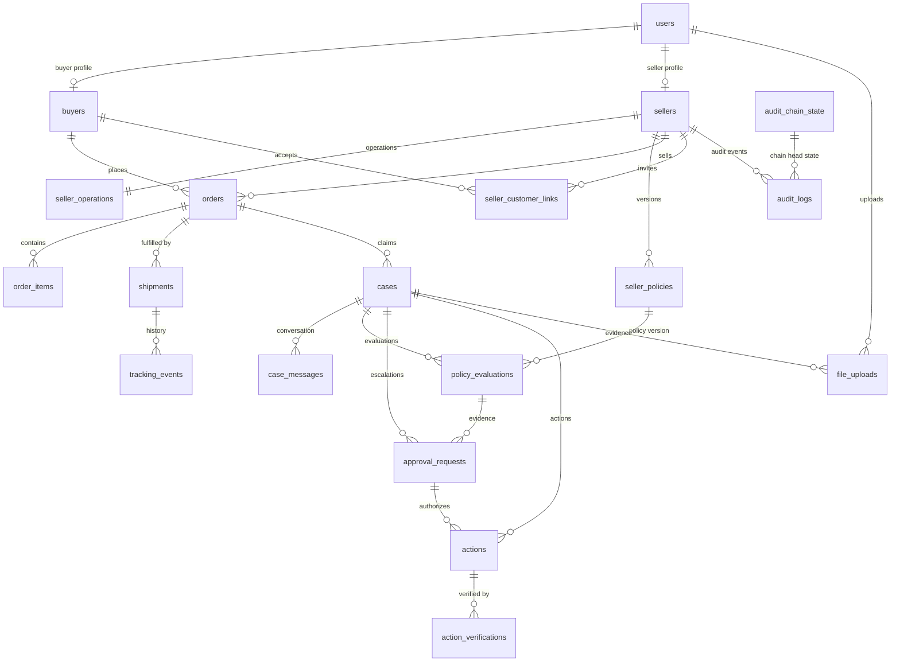
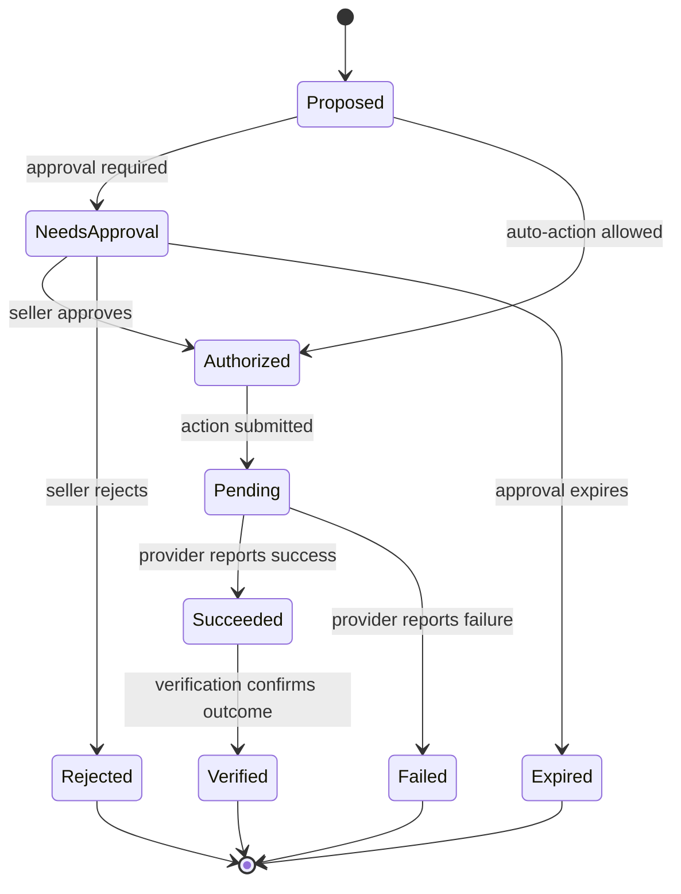
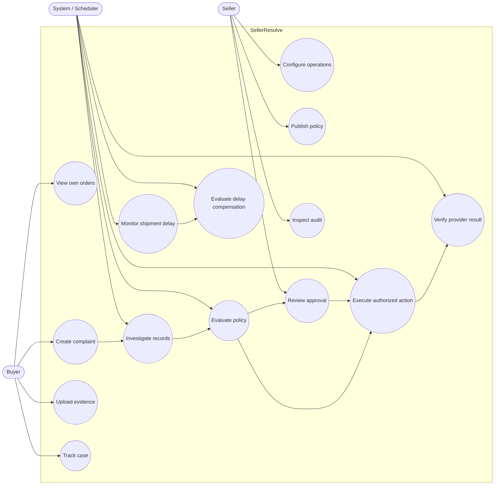
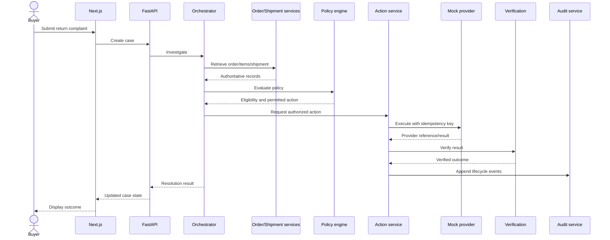
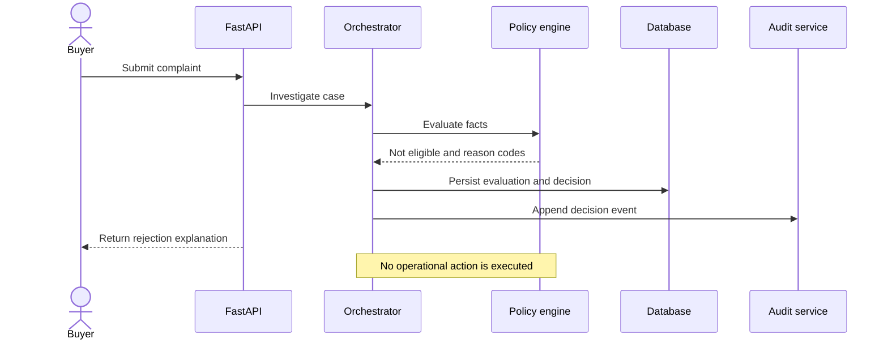
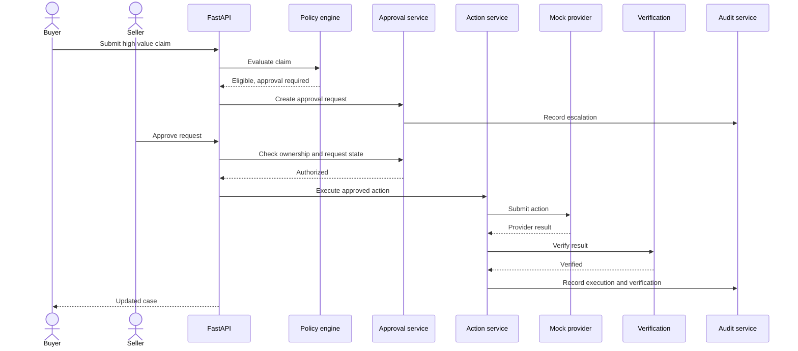
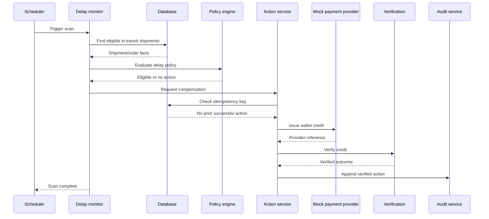

# SellerResolve Project Handover

**Team:** Break The Bug  
**Hackathon:** AgentX Hackathon 2026, PS-04  
**Product:** SellerResolve  
**Tagline:** Investigate. Decide. Act. Verify.  
**Status:** Draft based on the repository snapshot shared on 11 November 2026. Items marked **OPEN** or **VERIFY** require confirmation against the final working tree and runtime.

## 1. Executive summary

SellerResolve is an autonomous, policy-aware support and resolution system for online sellers. It handles post-purchase issues such as returns, refunds, damaged or incorrect items, shipment delays, and order tracking.

It is not merely a chatbot. It retrieves trusted order and shipment facts, evaluates seller-defined rules using deterministic Python logic, obtains seller approval where required, executes an operational action through a provider adapter, verifies the provider outcome, and records the lifecycle in an audit trail.

**Critical boundary:** The LLM may interpret customer language and explain outcomes. It must not decide policy eligibility, calculate authorized financial amounts, bypass approval, or claim an action succeeded without provider verification.

### Current technology

- Frontend: Next.js 16 (`apps/web/`)
- Backend: FastAPI (`apps/api/`)
- ORM and migrations: SQLAlchemy and Alembic
- Runtime database target: PostgreSQL
- Database: PostgreSQL only
- Policy validation: Pydantic and deterministic Python rules
- Operational providers: deterministic mock payment and courier adapters
- Audit: SHA-256 hash-chained records
- Background work: proactive shipment-delay monitor

This is a hackathon prototype. Do not describe it as production-ready or claim live payment/courier integration.

## 2. Problem, objectives and scope

Small and medium online sellers receive repeated post-purchase requests. Manual handling is slow and inconsistent. Chatbots can explain policies but generally cannot establish authoritative facts, enforce seller-specific rules, perform authorized operations, or verify that those operations succeeded.

SellerResolve aims to:
1. Give buyers a structured complaint and case-tracking flow.
2. Give sellers control over policies, operations, and approval thresholds.
3. Retrieve authoritative order, item, shipment, and tracking facts.
4. Evaluate policy eligibility deterministically.
5. Separate eligibility, approval, execution, and verification.
6. Prevent duplicate financial actions with idempotency controls.
7. Escalate cases requiring seller authorization.
8. Verify provider outcomes before marking actions completed.
9. Maintain an auditable decision/action history.
10. Detect eligible shipment delays proactively.

Out of scope for the current prototype: live vendor integrations, distributed microservices, production-grade multi-region deployment, and claims that a hash chain is impossible for a privileged attacker to rewrite.

## 3. Actors and responsibilities

| Actor | Responsibilities |
|---|---|
| Buyer | View own orders, create complaints, upload evidence, follow case status and receive outcomes |
| Seller | Complete onboarding, configure operations, publish policies, manage orders/customers, approve escalations, inspect audit records |
| System | Authenticate and authorize, investigate records, evaluate policy, create approvals, execute and verify actions, monitor delays, append audit records |

## 4. Functional modules

### Buyer workflows
- Order access and seller discovery, as supported by the current UI/API.
- Complaint creation.
- Case conversation and streaming status updates.
- Evidence upload.
- Case status and resolution visibility.

### Seller workflows
- Seller onboarding and operational configuration.
- Policy configuration and publication/versioning.
- Order and customer operations.
- Approval queue.
- Audit viewer and export, subject to the current API implementation.

### Operational actions
- Return-label creation.
- Refund execution.
- Wallet-credit issuance.
- Manual review/escalation.
- Rejection when policy requirements are not met.

**Provider limitation:** Payment and courier integrations are mocks. Passing mock tests does not prove behavior against a live vendor API.

## 5. System architecture



### Frontend

The frontend is in `apps/web/`. The repository snapshot identifies buyer routes for directory/orders/complaints/chat and seller routes for onboarding/policies/approvals/audit.

Relevant files identified:
- `apps/web/app/buyer/complaints/new/page.tsx`
- `apps/web/app/seller/approvals/page.tsx`
- `apps/web/app/seller/policies/page.tsx`
- `apps/web/app/seller/audit/page.tsx`

**VERIFY:** Confirm the final route tree and browser behavior against the final branch. Type-checking and a production build do not prove that every screen works.

### Backend

The backend is in `apps/api/`. It contains API endpoints, authentication, agent orchestration, deterministic policy logic, approval handling, action execution, provider adapters, verification, evidence handling, proactive monitoring, and audit services.

Keep this as a modular monolith. There is no need to introduce microservices for this handover.

### LLM boundary

The LLM may interpret messages, extract details, and phrase explanations. It must not decide eligibility, calculate refunds, establish ownership, authorize an approval, execute an action, or declare provider success.

## 6. Core business lifecycle

1. **Case intake:** buyer reports an issue.
2. **Investigation:** retrieve order, item, shipment, and tracking facts.
3. **Policy evaluation:** deterministic rules determine eligibility and permitted next step.
4. **Approval:** create a seller approval request if the action exceeds configured limits or otherwise requires authorization.
5. **Execution:** submit an authorized action through the provider adapter.
6. **Verification:** verify the provider outcome.
7. **Audit:** record decisions, approvals, attempts, and outcomes.

A result such as `REFUND_APPROVED` is not the same as `REFUND_COMPLETED`. The policy engine must not set an action to `executed`. Only a verified provider outcome should allow the case/action to reach its completed state.

### Policy evaluation order

The policy documentation lists this order:
1. Seller must be active.
2. Validate case/order/buyer ownership and issue category.
3. Check duplicate claims and policy availability.
4. Check currency.
5. Check delivery data when required.
6. Check return and damage-reporting windows.
7. Check item returnability.
8. Check evidence requirements.
9. Check buyer refund-frequency risk.
10. Check monetary approval ceiling and delay-compensation rules.
11. Determine action: refund, wallet credit, return label, reject, or manual review.

See `docs/policy-schema.md` and `apps/api/app/services/policy/` for the detailed contract.

### Money representation

Persisted order/action money is intended to use integer minor units, such as paise for INR. Policy configuration may be entered in major units at the UI/config boundary and converted exactly once by backend helpers.

**P0 VERIFY:** The repository review identified a possible mismatch between the legacy order-money conversion helper and the normalization migration. The migration helper appears to multiply values by 100, while runtime conversion distinguishes integer and float legacy values. Establish the exact legacy field contract and add tests before trusting migrated financial records. Do not casually rewrite a migration already applied to a database with meaningful data. Use a corrective migration or controlled repair if needed.

## 7. Database and ER diagram

PostgreSQL is the only supported application database. Alembic is the schema authority. The application should not create production tables automatically at startup.

### ER diagram

This is based on the existing `docs/database-schema.md` ERD and entity names in the repository snapshot. Reconcile it against every SQLAlchemy model and Alembic migration before treating it as a final schema specification.



**ERD correction:** The previous diagram showed `audit_chain_state` and `audit_logs` as one-to-one. That is likely misleading. The state row represents the current chain head/sequence for a seller's audit sequence, not a parent row for every audit event. Confirm exact FK/cardinality in models and migrations.

### Entity responsibilities

| Entity | Responsibility |
|---|---|
| `users` | Shared authentication identity |
| `buyers` | Buyer profile |
| `sellers` | Seller profile and status |
| `seller_operations` | Seller operational settings |
| `seller_policies` | Versioned policy documents and publication metadata |
| `seller_customer_links` | Seller/buyer invite relationship |
| `orders` | Order-level seller, buyer, and financial data |
| `order_items` | Normalized line items, quantity, SKU, price, returnability |
| `shipments` | Shipment and delivery state |
| `tracking_events` | Normalized tracking history |
| `cases` | Complaint and resolution lifecycle |
| `case_messages` | Case conversation |
| `policy_evaluations` | Persisted deterministic results and policy-version reference |
| `approval_requests` | Seller authorization lifecycle |
| `actions` | Operational action records |
| `action_verifications` | Provider outcome verification |
| `file_uploads` | Evidence metadata and case/user association |
| `audit_logs` | Hash-chained audit events |
| `audit_chain_state` | Current chain head/sequence state |

This is a responsibility map, not a full column catalogue. Exact primary keys, foreign keys, indexes, uniqueness, nullability, and delete behavior must be copied from the final ORM/migrations.

### Normalized data

`order_items` and `tracking_events` are normalized tables. Legacy JSON snapshots remain for compatibility. Normalized rows should be treated as authoritative for relational queries; avoid creating two independent sources of truth.

### Policy versioning

Policy evaluations retain the exact policy version used. The refactor report describes publication metadata such as currency, content checksum, source, and publishing user. Published documents are intended to be immutable. Policy changes should create a new version.

### Action lifecycle



Conceptual lifecycle only. Use exact enum/state names from current code in the final schema documentation.

### Audit limitations

SHA-256 chaining makes unauthorized changes detectable when the chain is verified. It is tamper-evident, not absolutely tamper-proof. A sufficiently privileged attacker who can rewrite every audit row and the chain head could potentially reconstruct a valid chain. Stronger guarantees require independently anchored checkpoints, restricted database privileges, external immutable storage, or signed exports.

## 8. Use cases



| Use case | Actor | Preconditions | Outcome |
|---|---|---|---|
| Create complaint | Buyer | Authenticated; owns order | Case linked to order |
| Upload evidence | Buyer | Authorized for case | Validated evidence associated with case |
| Evaluate complaint | System | Case and order facts available | Deterministic result persisted |
| Approve escalation | Seller | Owns request; request actionable | Action authorized or rejected |
| Execute action | System | Authorized; idempotency checks pass | Provider action attempted and recorded |
| Verify action | System | Provider result/reference available | Verified outcome persisted |
| Publish policy | Seller | Authorized; policy validates | New policy version published |
| Monitor delay | Scheduler | Monitor running; shipment eligible | Compensation evaluated and, if authorized, executed once |
| Inspect audit | Seller | Authenticated; owns records | Audit history displayed/exported |

## 9. Sequence diagrams

### Standard return



### Policy rejection



### Seller approval



### Proactive delay compensation



**OPEN:** Verify that the scheduler is actually started by application lifespan or a separate process, that duplicate instances are prevented, and that restart/retry/shutdown behavior is defined. A monitor service class does not prove a continuously running scheduler.

## 10. API overview

The detailed contract belongs in `docs/API.md`; the current FastAPI route declarations are the source of truth. Functional groups identified in the repository include:

| API area | Responsibility |
|---|---|
| Authentication | Login/session and identity operations |
| Buyer | Seller discovery, orders, complaint creation, case details, chat and streaming |
| Seller | Onboarding, operations, policies, orders, customers, metrics and approvals |
| Audit | Seller audit history, verification and export |
| Uploads | Evidence upload and authorized download |

### Evidence upload contract documented in API reference

The API documentation describes `POST /uploads` as a multipart upload endpoint:
- Maximum upload size: 5 MB.
- Magic-byte validation for JPEG, PNG, and WebP.
- If `case_id` is supplied, caller must own the case as buyer or seller.
- Downloads are limited to uploader, case buyer, or case seller.
- Response includes file URL, filename, MIME type, and byte size.

**OPEN:** Confirm physical storage directory, Docker volume mapping, persistence after container recreation, backups, retention/deletion, and URL stability. Database metadata alone does not preserve binary uploads.

## 11. Security and integrity controls

The repository documentation/structure identifies:
- Argon2id password hashing.
- HMAC-backed sessions.
- CSRF protections.
- Rate limiting.
- Backend role and ownership checks.
- Evidence size and content-signature validation.
- Policy publication/version controls.
- Idempotency for operational actions.
- Seller approval for actions above configured limits.
- SHA-256 chained audit records.

Only describe a control as implemented after checking final code and tests. Frontend route guards do not replace backend authorization.

## 12. Canonical demo scenarios

These are fixture values, not universal policy defaults.

### Scenario 1: Eligible return
- Order: `ORD-1001`
- Unopened earbuds, $45.
- Delivered 5 days ago.
- Return window: 14 days.
- Auto-approval ceiling: $50.
- Expected: auto-approved return and label `RET-99214`, followed by verification.

### Scenario 2: Return outside policy
- Order: `ORD-1002`
- Apparel return after 22 days.
- Return window: 14 days.
- Expected: not eligible; no operational action.

### Scenario 3: High-value damage claim
- Order: `ORD-1003`
- Cracked display, $320, photo evidence.
- Auto-approval ceiling: $50.
- Expected: seller approval required; after approval, mock refund executes and is verified.

### Scenario 4: Proactive shipment delay
- Order: `ORD-1004`
- $110 order; in transit 6 days against a 5-day SLA.
- Expected: monitor detects delay and evaluates configured compensation.
- Wallet credit only if authorized.
- A second monitor cycle must not create a duplicate credit.

## 13. Repository map

```text
sellerresolve/
├── apps/
│   ├── api/
│   │   ├── alembic/versions/
│   │   ├── app/api/v1/endpoints/
│   │   │   ├── buyer/
│   │   │   ├── seller/
│   │   │   └── audit.py, auth.py, files.py
│   │   ├── app/core/
│   │   ├── app/db/
│   │   ├── app/models/
│   │   ├── app/schemas/
│   │   ├── app/services/
│   │   │   ├── actions/
│   │   │   ├── agent/
│   │   │   ├── policy/
│   │   │   └── monitor.py, audit.py
│   │   └── tests/
│   └── web/
│       ├── app/
│       └── lib/
├── docs/
├── scripts/
├── docker-compose.yml
├── Dockerfile.api
├── Dockerfile.web
├── Makefile
├── README.md
└── .env.example
```

Confirm exact filenames against the final branch before using this as a complete file inventory.

## 14. Developer setup

### Prerequisites
- Git
- Docker Desktop and Docker Compose
- Python 3.12+ (confirm supported version from project config)
- Node.js 22+
- pnpm

### Environment

1. Copy root `.env.example` to root `.env`, following the final configuration convention.
2. Set PostgreSQL credentials and `DATABASE_URL`.
3. Set a strong development `SECRET_KEY`.
4. Never commit `.env`.
5. Ensure FastAPI, Alembic, and Compose resolve the same intended configuration.

**P0 OPEN:** The reviewed snapshot showed a mismatch between the default database URL in `apps/api/app/core/config.py` and root `.env.example`. `env_file=".env"` can also resolve differently depending on process working directory. Remove hardcoded credentials, select one canonical env-file convention, and print/check the effective URL before migration.

### Start PostgreSQL

From repository root:

```powershell
docker compose config
docker compose up -d postgres
docker compose ps
docker compose logs postgres
```

Check health and port mapping before migrations. Do not use `docker compose down -v` for ordinary cleanup because it deletes named volumes and may destroy the local database.

### Backend

```powershell
cd apps/api
python -m venv .venv
.venv\Scripts\activate
python -m pip install -r requirements.txt
python -m alembic upgrade head
python -m alembic current
python -m alembic check
```

### Frontend

```powershell
cd apps/web
pnpm install
pnpm run dev
```

### Run services

Terminal 1, from `apps/api`:

```powershell
.venv\Scripts\python -m uvicorn app.main:app --port 8000 --reload
```

Terminal 2, from `apps/web`:

```powershell
pnpm run dev
```

Documented local URLs:
- Frontend: `http://localhost:3000`
- Backend: `http://localhost:8000`
- Development API docs: `http://localhost:8000/docs`

**P1 OPEN:** The reviewed runbook references `.\run.ps1 dev`, while the earlier Git status showed `run.ps1` as deleted. Restore it or remove the reference and document supported Makefile/direct commands.

## 15. Tests and verification

### Backend

From `apps/api`:

```powershell
.venv\Scripts\python -m pytest tests -q
```

The supplied refactor report records:
- SQLite in-memory: 102 passed, 4 skipped.
- PostgreSQL: 106 passed.

These are reported results, not tests independently rerun while preparing this document.

### Static checks

From `apps/api`:

```powershell
.venv\Scripts\python -m ruff check .
.venv\Scripts\python -m ruff format --check .
.venv\Scripts\python -m mypy app
```

From `apps/web`:

```powershell
pnpm run lint
node node_modules/typescript/bin/tsc --noEmit
pnpm run build
```

### End-to-end scenarios

From `apps/api`:

```powershell
.venv\Scripts\python ../../scripts/run-e2e-scenarios.py
```

The report says all four canonical scenarios and audit-chain verification passed. Re-run on the final branch.

### Docker PostgreSQL verification

The report explicitly says Docker PostgreSQL 17 was not the server used for reported database verification. Complete this on the target machine:

```powershell
docker compose config
docker compose up -d postgres
docker compose ps
docker compose logs postgres

cd apps/api
.venv\Scripts\alembic.exe upgrade head
.venv\Scripts\alembic.exe current
.venv\Scripts\alembic.exe check
.venv\Scripts\python -m pytest tests -q
```

Confirm the test URL targets the intended Docker service and an isolated schema, not valuable development/production data.

### Browser smoke tests

Manually test:
- Buyer complaint creation.
- Evidence upload and authorized download.
- Buyer case status and chat/streaming.
- Seller policy editing and publication confirmation.
- Approval queue approve/reject.
- Audit viewer/export.
- Loading, empty, error, and unauthorized states.

A successful build is not a browser test. Humans keep discovering this the hard way.

## 16. Known limitations and open risks

| Priority | Issue | Required action |
|---|---|---|
| P0 | Possible money conversion mismatch between migration and runtime helper | Define units, inspect migration history, add regression tests, repair existing data safely |
| P0 | Database URL/env-file inconsistency | Remove hardcoded credentials and make config resolution deterministic |
| P0 | `.gitignore` negation syntax may be invalid | Change `! .env.example` to `!.env.example`; verify with Git |
| P1 | `run.ps1` may be missing while runbook references it | Restore or update runbook |
| P1 | Docker PostgreSQL 17 not independently verified | Run migrations and integration tests against Compose DB |
| P1 | Scheduler lifecycle unclear | Verify startup, singleton behavior, retries, restart and shutdown |
| P1 | Evidence binary persistence unclear | Verify path, volume, authorization, backup, retention and deletion |
| P2 | Generated TypeScript build-info may be tracked | Ignore `*.tsbuildinfo`; remove generated tracked artifact if appropriate |
| P2 | Browser testing not shown as completed | Test buyer/seller flows manually |
| P2 | API documentation may drift | Reconcile docs with routes and frontend consumers |
| P2 | Nullable policy-evaluation ownership references need review | Confirm intended model and authorization implications |
| P2 | Audit-chain trust boundary needs precise wording | Call it tamper-evident; consider external anchoring |
| P2 | Concurrency stress tests absent | Add multi-process idempotency, audit append, and policy publication tests |
| P2 | Legal pages need review | Replace placeholders and obtain appropriate review |

### Money migration test cases

Test the chosen contract for:
- Integer legacy values.
- Float major-unit values.
- Explicit `*_minor` values.
- Zero and null.
- Negative values if allowed.
- Invalid strings.
- Booleans, which Python treats as integers unless rejected explicitly.
- Representative rows from an existing database.

Before changing a migration, establish whether it has already been applied to a database with meaningful data. Prefer a corrective migration or controlled repair over rewriting migration history.

### Git/environment checks

If the current `.gitignore` contains whitespace after `!`, correct it:

```gitignore
!.env.example
!apps/api/.env.example
```

Then run:

```powershell
git check-ignore -v .env.example apps/api/.env.example
git ls-files .env.example apps/api/.env.example
git status --short
```

Never commit the real `.env`.

## 17. Backup and migration safety

Before a migration or data repair:
1. Stop processes that may write to the database.
2. Take a database backup.
3. Record the current Alembic revision.
4. Confirm target host, port, and database.
5. Apply the migration to a disposable copy first.
6. Verify row counts and representative financial values.
7. Run integrity checks and canonical E2E scenarios.
8. Retain the backup until the repaired database is validated.

Use the team's approved PostgreSQL `pg_dump`/`pg_restore` procedure. Do not use volume deletion as a reset shortcut.

## 18. Handover checklist

### Repository
- [ ] Final branch and commit hash recorded.
- [ ] No uncommitted changes unintentionally omitted.
- [ ] Secrets and `.env` are not committed.
- [ ] `.gitignore` behavior verified.
- [ ] Runbook commands point to files that exist.
- [ ] Generated artifacts are not accidentally tracked.

### Database
- [ ] Money unit contract documented and tested.
- [ ] Migration safe for existing data.
- [ ] Backup/restore procedure tested.
- [ ] Docker PostgreSQL version verified.
- [ ] Alembic upgrade/current/check completed.
- [ ] ERD reconciled against ORM and migrations.
- [ ] Constraints and indexes documented.

### Application
- [ ] Backend tests pass on final branch.
- [ ] Frontend lint/type-check/build pass.
- [ ] Four canonical scenarios pass.
- [ ] Buyer and seller browser flows tested.
- [ ] Evidence persists across container restart.
- [ ] Scheduler startup and duplicate prevention verified.
- [ ] Mock providers clearly identified.

### Handover
- [ ] README and runbook updated.
- [ ] API docs reconciled with actual endpoints.
- [ ] Architecture and diagrams reviewed.
- [ ] Known limitations disclosed.
- [ ] Demo seed/credential instructions provided securely.
- [ ] Owner assigned to each unresolved issue.

## 19. Recommended order under time pressure

1. Freeze the current state: commit or archive it and record the commit hash.
2. Fix P0: money conversion contract, environment configuration, and `.gitignore`.
3. Verify Docker PostgreSQL, effective connection URL, migrations, and DB tests.
4. Verify scheduler lifecycle and evidence persistence.
5. Run all four canonical scenarios. Confirm no duplicate financial action and no action is marked executed before verification.
6. Run frontend checks and browser smoke tests.
7. Replace every **VERIFY** and **OPEN** marker in this document with a verified result or a clearly stated limitation.
8. Commit the final handover package.

Do not spend the remaining time polishing low-risk details while financial correctness is uncertain.

## 20. Primary source files

- `README.md`
- `docs/architecture.md`
- `docs/API.md`
- `docs/database-schema.md`
- `docs/database-refactor-plan.md`
- `docs/database-refactor-report.md`
- `docs/policy-schema.md`
- `docs/runbook.md`
- `apps/api/app/models/`
- `apps/api/app/services/policy/`
- `apps/api/app/services/actions/`
- `apps/api/app/services/agent/`
- `apps/api/app/services/monitor.py`
- `apps/api/app/services/audit.py`
- `apps/api/app/core/config.py`
- `apps/api/alembic/versions/`
- `apps/api/tests/`
- `apps/web/app/`
- `docker-compose.yml`
- `.env.example`

## Final handover statement

SellerResolve is a modular, policy-aware resolution prototype with a deterministic policy boundary, explicit approval/action lifecycles, mock operational providers, and a hash-chained audit design. The supplied refactor report records substantial automated test and static-check coverage. However, the final handover must not claim Docker PostgreSQL 17, live provider integrations, browser-level UI behavior, scheduler deployment lifecycle, or evidence-volume persistence are verified unless those checks are completed on the final working branch.

The most urgent technical risk is the possible inconsistency in legacy money conversion. Resolve it before trusting migrated financial records or presenting the database refactor as complete.
