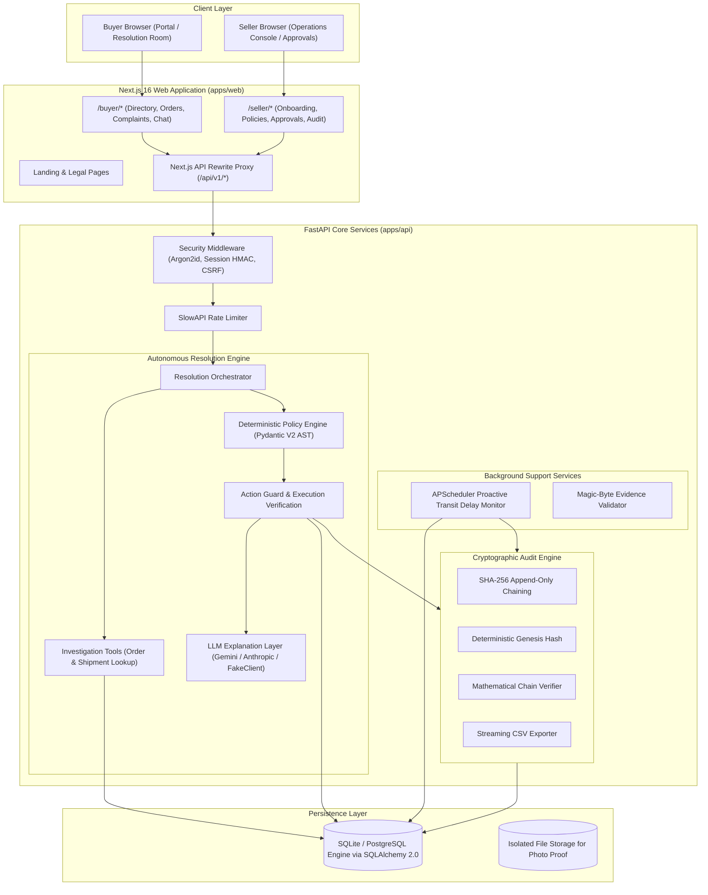
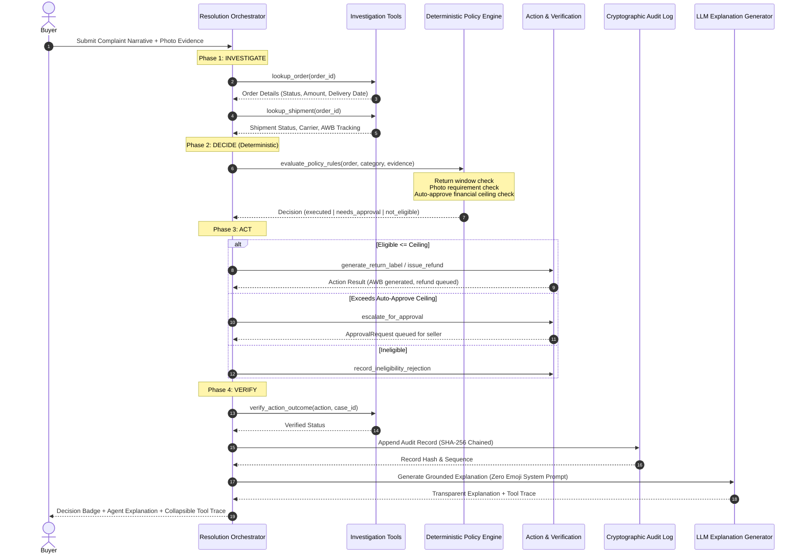

# SellerResolve System Architecture

**Team:** Break The Bug  
**Hackathon:** AgentX Hackathon 2026 (PS-04)  
**Product:** SellerResolve — Autonomous, Policy-Aware Support Agent  
**Tagline:** *Investigate. Decide. Act. Verify.*

---

## 1. System Vision & Core Value Proposition

For small and medium online sellers, customer support is dominated by post-purchase queries: returns, refunds, order tracking, and transit delays. Standard chatbots fail because they merely answer questions with text, hallucinate policy exceptions, or cannot take action safely.

SellerResolve operates as an autonomous operational resolution engine:
1. **Investigates** authenticated order, shipment, and payment records.
2. **Decides** eligibility using the seller's deterministic policies (not LLM discretion).
3. **Acts** safely by creating return labels, triggering refunds, or escalating to the seller.
4. **Verifies** the operational outcome with external courier and payment connectors.
5. **Logs** every turn, tool invocation, and decision into a mathematically tamper-evident SHA-256 chained audit trail.

---

## 2. High-Level Architecture Diagram

---

## 3. The 4-Phase Resolution Lifecycle

---

## 4. Key Architectural Guarantees & Non-Negotiables

### 1. Deterministic Policy Boundary (No LLM Hallucinations)
- The LLM **never** decides refund eligibility, policy windows, or financial amounts.
- The policy AST is parsed from seller YAML and evaluated strictly in Python.
- If an order is delivered 22 days ago and the return policy is 14 days, the engine deterministically rejects the claim (`not_eligible`), irrespective of customer prompts.

### 2. Strict Server-Side Identity Scoping
- `buyer_id`, `seller_id`, and `order_id` are injected server-side from session tokens and database associations.
- A buyer cannot access or resolve claims for another buyer's orders.
- Multi-tenant seller separation is enforced across every query.

### 3. Cryptographic Audit Log (SHA-256 Hash Chaining)
- Every audit record contains:
  $$\text{Record Hash} = \text{SHA256}(\text{prev\_hash} \parallel \text{timestamp} \parallel \text{seller\_id} \parallel \text{case\_id} \parallel \text{action} \parallel \text{payload})$$
- The genesis record links to an initial genesis hash.
- Any manual modification, deletion, or reordering of records mathematically invalidates subsequent hashes and is instantly caught by `AuditLogService.verify_chain()`.

### 4. Proactive Background Monitor
- An automated scheduler checks active in-transit shipments without waiting for a customer complaint.
- Stalled packages exceeding seller SLA automatically receive wallet credits and proactive notification cases.

### 5. Zero Emoji & Zero Runtime Assets
- The entire codebase, agent replies, UI copy, and system logs enforce the strict zero-emoji mandate.
- All visual assets are 100% self-hosted SVGs and canvas animations; zero external blob dependencies.
