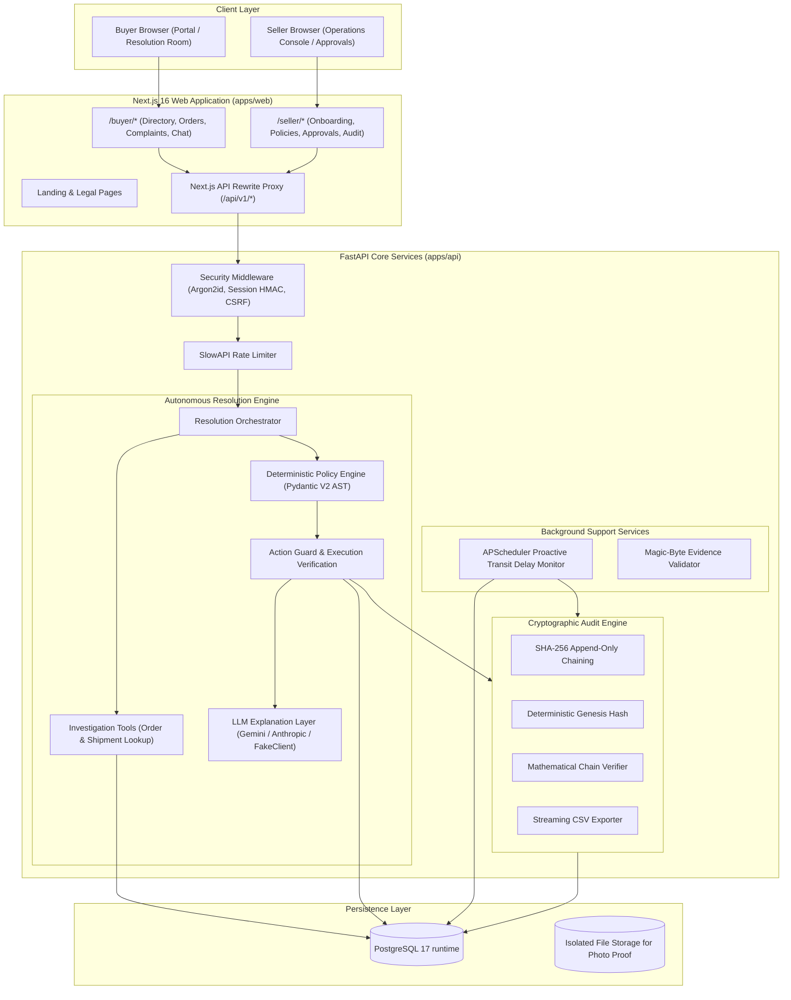
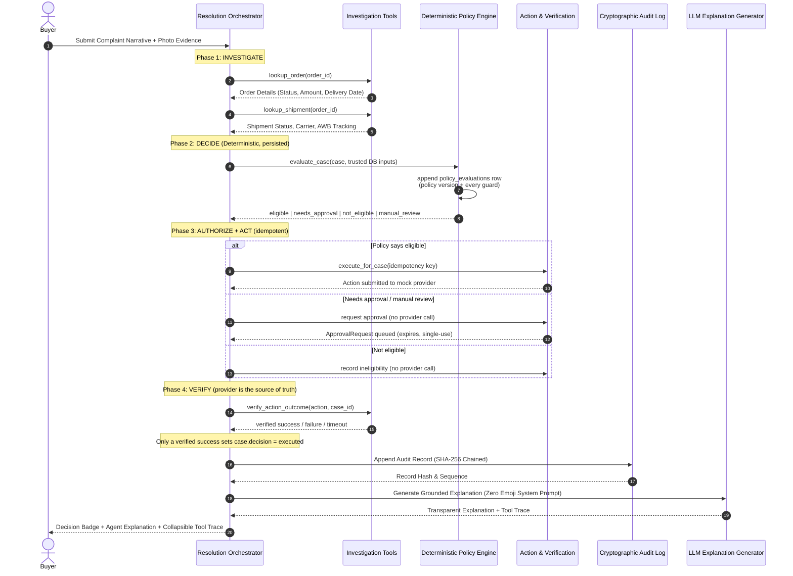

# SellerResolve System Architecture

**Team:** Break The Bug  
**Hackathon:** AgentX Hackathon 2026 (PS-04)  
**Product:** SellerResolve — Autonomous, Policy-Aware Support Agent  
**Tagline:** *Investigate. Decide. Act. Verify.*

---

## 1. System Vision & Core Value Proposition

For small and medium online sellers, customer support is dominated by post-purchase queries: returns, refunds, order tracking, and transit delays. Standard chatbots fail because they merely answer questions with text, hallucinate policy exceptions, or cannot take action safely.

SellerResolve operates as an autonomous operational resolution engine:
1. **Investigates** authenticated order, shipment, and payment records.
2. **Decides** eligibility using the seller's deterministic policies (not LLM discretion).
3. **Acts** safely by creating return labels, triggering refunds, or escalating to the seller.
4. **Verifies** the operational outcome with external courier and payment connectors.
5. **Logs** every turn, tool invocation, and decision into a mathematically tamper-evident SHA-256 chained audit trail.

---

## 2. High-Level Architecture Diagram

---

## 3. The 4-Phase Resolution Lifecycle

---

## 4. Key Architectural Guarantees & Non-Negotiables

### 1. Deterministic Policy Boundary (No LLM Hallucinations)
- The LLM **never** decides refund eligibility, policy windows, or financial amounts.
- The policy document is validated by Pydantic and evaluated by a pure Python engine over trusted database inputs (`app/services/policy`).
- Sellers author policies as typed JSON in the console; `app/services/policies.py` validates the document, renders canonical YAML, accepts optional YAML edits through the same schema, and persists an immutable version with an explicit currency and checksum only after the seller confirms publication.
- If an order is delivered 22 days ago and the return policy is 14 days, the engine deterministically rejects the claim (`not_eligible`), irrespective of customer prompts.
- Every evaluation is appended to `policy_evaluations` with the exact stored policy version and all guard results, so a decision can be explained after the policy changes.
- A **policy decision is not an outcome**. The engine returns only `eligible`, `needs_approval`, `not_eligible` or `manual_review`; the `executed` badge is produced exclusively by a verified action.

### 1b. Idempotent Execution and Verification
- Actions are durable rows keyed by `(seller_id, idempotency_key)`, where the key is derived from the action type, seller, case/order, amount and policy version.
- The provider call happens outside the transaction, and the action is only `succeeded` after a verification lookup confirms it.
- A retry (including a retry after a timeout) finds the original action and the provider's recorded operation instead of paying twice.
- Approvals authorize execution; they never stand in for it. A failed verification leaves the case unresolved and the failure is visible in the tool trace and audit log.

### 2. Strict Server-Side Identity Scoping
- `buyer_id`, `seller_id`, and `order_id` are injected server-side from session tokens and database associations.
- A buyer cannot access or resolve claims for another buyer's orders.
- Multi-tenant seller separation is enforced across every query.

### 3. Cryptographic Audit Log (SHA-256 Hash Chaining)
- Every audit record contains:
  $$\text{Record Hash} = \text{SHA256}(\text{prev\_hash} \parallel \text{timestamp} \parallel \text{seller\_id} \parallel \text{case\_id} \parallel \text{action} \parallel \text{payload})$$
- The genesis record links to an initial genesis hash.
- Any manual modification, deletion, or reordering of records mathematically invalidates subsequent hashes and is instantly caught by `AuditLogService.verify_chain()`.

### 4. Proactive Background Monitor
- An automated scheduler checks active in-transit shipments without waiting for a customer complaint.
- Stalled packages exceeding seller SLA automatically receive wallet credits and proactive notification cases.

### 5. Normalized Data Model with Compatibility Snapshots
- Order lines, tracking events, policy evaluations, actions and verification attempts are relational tables.
- The legacy JSON columns (`orders.items`, `shipments.tracking_events`, `cases.evidence_urls`) are retained as read-only projections so existing API and UI payloads keep working; reads prefer the relational rows.
- Cross-tenant integrity is enforced by the database (unique order numbers per seller, composite `cases -> orders` foreign key, one active policy per seller), not only by service code.

### 6. Zero Emoji & Zero Runtime Assets
- The entire codebase, agent replies, UI copy, and system logs enforce the strict zero-emoji mandate.
- All visual assets are 100% self-hosted SVGs and canvas animations; zero external blob dependencies.
