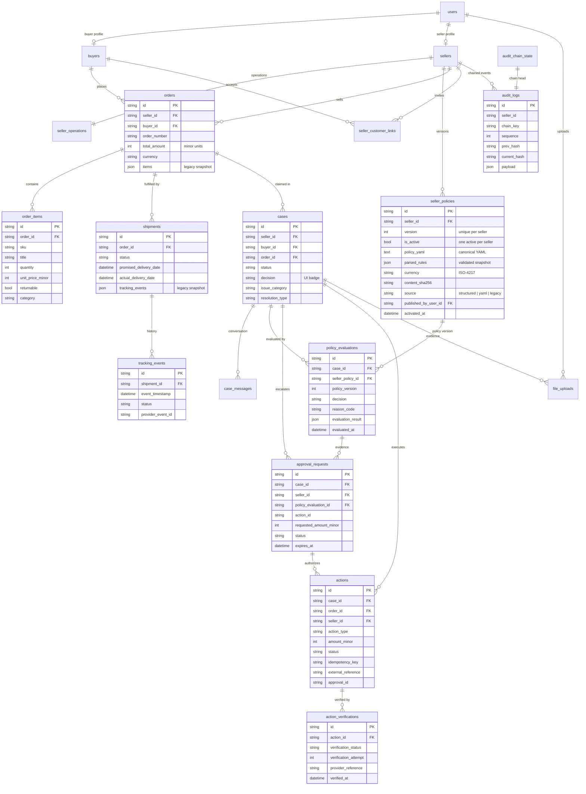

# SellerResolve Database Schema

PostgreSQL is the runtime database. SQLite remains supported for tests and
throwaway local runs. The schema is created exclusively by Alembic
(`alembic upgrade head`); the application never calls `create_all` outside tests.

## 1. Entity relationship diagram

## 2. Authoritative data vs compatibility snapshots

| Concern | Authoritative | Compatibility projection |
| --- | --- | --- |
| Order lines | `order_items` | `orders.items` (read-only JSON snapshot) |
| Tracking history | `tracking_events` | `shipments.tracking_events` (read-only JSON snapshot) |
| Case evidence | `file_uploads.case_id` | `cases.evidence_urls` |
| Policy decision | `cases.decision` (UI badge) + `policy_evaluations` (audit log) | `cases.outcome_details` |
| Execution | `actions` + `action_verifications` | `cases.outcome_details`, order payment status |

`orders.items` and `shipments.tracking_events` are written **only** by
`app/services/orders.py` (`sync_order_items`, `sync_tracking_events`), which keeps
the snapshot consistent with the rows. Readers prefer the normalized rows and
fall back to the snapshot for data written before the refactor.

## 3. Integrity constraints

| Constraint | Purpose |
| --- | --- |
| `uq_orders_seller_order_number (seller_id, order_number)` | Order numbers are unique per tenant, not globally. |
| `uq_orders_id_seller_id (id, seller_id)` | Parent key for the composite case foreign key. |
| `fk_cases_seller_order (cases.seller_id, cases.order_id) -> orders(seller_id, id)` | A case can never point at another seller's order. |
| `uq_seller_policies_seller_version (seller_id, version)` | Policy versions are unambiguous. |
| `uq_seller_policies_one_active` (partial, `WHERE is_active`) | At most one active policy per seller. |
| `uq_actions_seller_idempotency (seller_id, idempotency_key)` | A retried operation cannot create a second action. |
| `uq_tracking_events_shipment_provider_event` (partial) | Provider events are unique per shipment when an id is present. |
| `ck_order_items_quantity_positive`, `ck_actions_amount_non_negative` | Amount/quantity sanity at the storage layer. |
| `uq_audit_logs_chain_sequence (chain_key, sequence)` | One audit sequence number per chain. |

Buyer/order consistency (`cases.buyer_id` matches `orders.buyer_id`) is enforced in
the policy evaluator (`BUYER_OWNERSHIP_MISMATCH`) rather than by a composite
foreign key, because orders may be unclaimed (`orders.buyer_id IS NULL`) before a
buyer links them.

## 4. Money and time

- All persisted amounts are integer **minor units** (`total_amount`,
  `unit_price_minor`, `amount_minor`, `requested_amount_minor`).
- Seller policy documents keep their documented **major-unit** values
  (`auto_approve_up_to: 500`) and an explicit `seller_policies.currency`; the
  engine converts exactly once at its boundary (`app.schemas.policy.to_minor_units`,
  `paise = rupees * 100`) and the API returns the derived `monetary_minor`
  snapshot for previews and reviews.
- A published policy row stores canonical YAML, the validated `parsed_rules`
  snapshot, the row `version`, `currency`, `content_sha256`, `source` and
  `published_by_user_id`. Content columns are immutable; only `is_active` may
  change when the next version is activated.
- All timestamps are timezone-aware UTC (`DateTime(timezone=True)`).

## 5. Audit chain

- Each seller has its own SHA-256 chain: `chain_key = seller_id`; legacy/global
  rows use `__global__`.
- `audit_chain_state` stores the head (`last_hash`, `last_sequence`) and is locked
  with `SELECT ... FOR UPDATE` while appending, which serializes concurrent writes
  per seller.
- Appends are part of the caller's transaction (`log_action(..., commit=False)`),
  so a failed business transaction does not leave a "successful" audit entry.
- Pre-existing rows keep their stored hashes and payloads; the migration only adds
  `chain_key`/`sequence` metadata and rebuilds `audit_chain_state`.

## 6. Migration history

| Revision | Purpose |
| --- | --- |
| `73fa33a3a744` | Baseline (users/audit log). Never rewritten. |
| `3d74bdde4fe4` | Core domain tables. Never rewritten. |
| `9a1f0b6c4d21` | Normalized order/tracking tables, policy evaluations, actions, verification, audit chain metadata, integrity constraints, backfills. |
| `c4b7e2d9a1f3` | Policy publication metadata: `currency`, `content_sha256`, `source`, `published_by_user_id`; backfills checksums and currency for existing versions. |

The incremental revisions are reversible. Downgrading `9a1f0b6c4d21` drops the
normalized/action tables (execution and evaluation history cannot be reconstructed)
but preserves the legacy JSON snapshots, so the pre-migration API shape still
works. Downgrading `c4b7e2d9a1f3` drops only publication metadata; policy documents
and versions are untouched.
